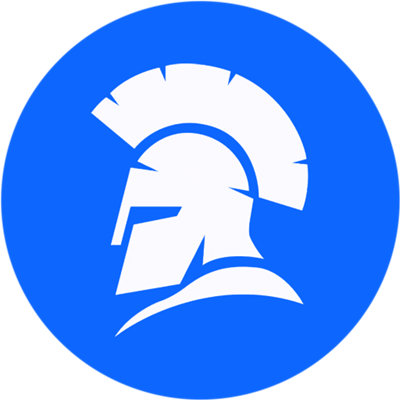

<!-- mcp-name: com.idosgames/platform -->
<!-- mcp-name: com.idosgames/sdk -->

<p align="center">
  
</p>

# iDos Games MCP

Official [Model Context Protocol](https://modelcontextprotocol.io) servers for
[iDos Games](https://idosgames.com), a backend and publishing platform for cross-platform games (web, Android, iOS, PC) with web3 support. Connect them to Claude,
ChatGPT, Cursor, VS Code, Codex or any other MCP client, and your AI assistant can build, configure and ship
your games.

There are two servers, and they do different jobs:

| | **iDos Games** (`com.idosgames/platform`) | **iDos Games SDK** (`com.idosgames/sdk`) |
|---|---|---|
| What it works on | Your live games: their **data**; plus the game modules and SDK skills | Game **code** in your project: modules and skills, offline |
| Where it runs | Hosted: `https://site.idosgames.com/api/v2/mcp` | Locally: `npx -y @idosgames/mcp` |
| Transport | Streamable HTTP | stdio |
| Sign-in | OAuth 2.1, you pick the games and permissions (modules and skills work without it) | None (public, read-only) |
| Works in browser-only clients (claude.ai, ChatGPT) | Yes | No, it needs a client that can start a local process |

Both serve the same catalog of game modules, the project scaffold and SDK skills, so a browser-only client
(claude.ai, ChatGPT) gets them from the hosted server. A game's live config, generated assets, task board and
builds go only through the **iDos Games** server; the **SDK** server needs no sign-in and works offline.

## iDos Games (hosted)

What your assistant can do with it:

- **Find your games** by name and see what it is allowed to do in each (`list_my_titles`).
- **Read and update game configuration** section by section: virtual currencies, items, store, lootboxes,
  quests, timed and co-op events, seasons, leaderboards, crafting, rewards, premium, tutorials, A/B
  experiments, localization, chat, multiplayer, push, advertising and more (`get_<section>` / `save_<section>`).
  Each section is saved on its own, so the rest of the configuration stays untouched.
- **Web3**: game currencies as on-chain tokens and items as NFTs on EVM networks and Solana, player deposits
  and withdrawals through the reward pool, token-gated play and wallet login, networks, contract addresses and
  gas policy (`get_blockchain` / `save_blockchain`, crypto currencies in `save_currency`, NFT items in
  `save_item`). Token launch and holder staking live on idosgames.com itself.
- **Title data and localization keys**: the game's shared key-value data and its text keys.
- **Server logic**: publish CloudCode, and list secret names (values are never returned).
- **Generate assets with AI**: images, speech and sound, music, short videos, 3D models and text. Generation
  spends your account's credits, so the assistant can check `list_ai_tiers` and `estimate_media_cost` before
  running it.
- **Task board**: projects, columns, cards, assignees and comments.
- **Ship builds**: upload a ready web build, get a test link, then put it live for players.
- **Game modules and SDK skills** (read-only, no game needed): the project scaffold (`get_host_scaffold`), ready
  games and systems such as store, quests, inventory, leaderboard and multiplayer (`list_modules`,
  `search_modules`, `get_module`), exact SDK package versions (`get_manifest`) and how-to skills for the SDK
  (`list_skills`, `get_skill`).
- **Video studio catalog** (read-only, no game needed): the formats of short videos and everything a video can
  name (`list_video_formats`, `get_video_format`), the library of ready characters, scenes and music
  (`search_assets`) and complete example videos (`list_video_templates`).
- **Write videos for the video studio** (paid with credits): `plan_video` turns an idea into a ready video by the
  studio's AI director, `generate_asset` makes a character, scene, prop or music for it and puts it in its place.
  The answer is the video package (`{ spec, assets }`) and a link that opens it in the app's editor; the MP4 is
  made on the player's device. `publish_asset` puts the assets into the app's Workshop as its official content.

Every tool has a `title` and `readOnlyHint` / `destructiveHint` / `openWorldHint` annotations.

### How sign-in works

Add the server as a plain HTTP MCP server with **no headers and no API key**. `initialize` and `tools/list`
need no sign-in. The first tool call answers `401`, your client opens the iDos Games sign-in page, and you pick
which games the assistant may use and what it may do in each (read config, write config, generate assets,
upload builds…). The client then repeats the call. You can revoke access at any time in **Connected apps** on
[platform.idosgames.com](https://platform.idosgames.com).

### Connect

**Claude (claude.ai, Desktop, mobile)**: Settings → Connectors → *Add custom connector* →
`https://site.idosgames.com/api/v2/mcp`.

**Claude Code**

```bash
claude mcp add --transport http idosgames https://site.idosgames.com/api/v2/mcp
```

**ChatGPT**: Settings → Apps & Connectors → Advanced → Developer mode → *Create*, URL
`https://site.idosgames.com/api/v2/mcp`, authentication **OAuth**.

**Codex CLI**

```bash
codex mcp add idosgames --url https://site.idosgames.com/api/v2/mcp
```

**Gemini CLI**

```bash
gemini mcp add --transport http idosgames https://site.idosgames.com/api/v2/mcp
```

**Cursor** (`.cursor/mcp.json`), **Windsurf** (`~/.codeium/windsurf/mcp_config.json`, key `serverUrl`),
**VS Code** (`.vscode/mcp.json`): see [Both servers in one config](#both-servers-in-one-config).

## iDos Games SDK (local)

Serves the iDos Games **Module & Skills Registry** to coding agents:

| Tool | Purpose |
|---|---|
| `list_modules` | Catalog of composable game modules (games and systems: store, quests, inventory, leaderboard…) |
| `get_module` | One module's full source and install instructions |
| `get_host_scaffold` | The base every new project starts from (sign-in, lobby, config) |
| `get_manifest` | Runtime `@idosgames/*` packages and their exact versions |
| `list_skills` / `get_skill` | How to code against `@idosgames/core`, the module contract and composition |
| `search` | Find a ready module by the feature you need |
| `validate_asset` / `validate_video` | Check a video-studio asset or video package with the studio's own code; with `title_id` — the link that opens the video in the app |

All tools are read-only and return content. The agent writes the files into its own project. The registry is
bundled in the package, so it also works offline.

```bash
claude mcp add idosgames-sdk -- npx -y @idosgames/mcp
```

npm: [`@idosgames/mcp`](https://www.npmjs.com/package/@idosgames/mcp).

## Both servers in one config

Cursor, `.cursor/mcp.json`:

```json
{
  "mcpServers": {
    "idosgames": { "url": "https://site.idosgames.com/api/v2/mcp" },
    "idosgames-sdk": { "command": "npx", "args": ["-y", "@idosgames/mcp"] }
  }
}
```

VS Code, `.vscode/mcp.json`:

```json
{
  "servers": {
    "idosgames": { "type": "http", "url": "https://site.idosgames.com/api/v2/mcp" },
    "idosgames-sdk": { "type": "stdio", "command": "npx", "args": ["-y", "@idosgames/mcp"] }
  }
}
```

Windsurf, `~/.codeium/windsurf/mcp_config.json`:

```json
{
  "mcpServers": {
    "idosgames": { "serverUrl": "https://site.idosgames.com/api/v2/mcp" },
    "idosgames-sdk": { "command": "npx", "args": ["-y", "@idosgames/mcp"] }
  }
}
```

Claude Code, `.mcp.json`:

```json
{
  "mcpServers": {
    "idosgames": { "type": "http", "url": "https://site.idosgames.com/api/v2/mcp" },
    "idosgames-sdk": { "command": "npx", "args": ["-y", "@idosgames/mcp"] }
  }
}
```

## Example prompts

- "Show the virtual currencies and store items configured for my game."
- "Add a daily quest that rewards 100 gold for winning 3 matches."
- "Generate a 512×512 icon for a fire sword and add it to the item catalog."
- "Start a new idle RPG project with a store and daily quests." (SDK server)
- "Build the game and upload it as a test version." (both servers)
- "What tasks are assigned to me on my board?"

## Links

- Documentation: [idosgames.com/mcp](https://idosgames.com/mcp)
- Support: [idosgames.com/mcp#support](https://idosgames.com/mcp#support), help@idos.games
- Privacy policy: [idosgames.com/privacy](https://idosgames.com/privacy)
- Terms: [idosgames.com/terms](https://idosgames.com/terms)

## License

The SDK server (`@idosgames/mcp`) is MIT-licensed; see [LICENSE](LICENSE). The hosted iDos Games server is a
service covered by the iDos Games [terms](https://idosgames.com/terms).
